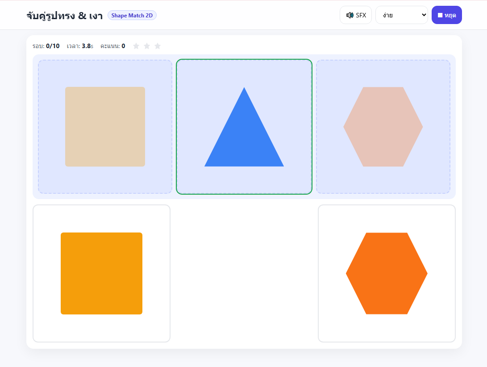

# Shape Match 2D

A browser puzzle game where players drag 2D shapes onto their matching shadows. Works with both mouse and touch screens.

เกมจับคู่รูปทรงกับเงา 2D ลากและวางชิ้นส่วนให้ตรงกับเงา

**Play it:** https://polypiku09-crypto.github.io/shape-match-2d/

## Features
- Drag-and-drop gameplay with mouse and touch support
- Difficulty levels to choose from before starting
- Score and star rating at the end of each round
- Sound effects
- Pause and resume
- "How to play" screen

## Tech Stack
HTML, CSS and vanilla JavaScript, with no libraries or build step.

## Run Locally

Open `index.html` in a browser.

## My Role

<!-- Write 2–3 lines in your own words: what you designed and built yourself. -->

---
Built as a university mini project.
